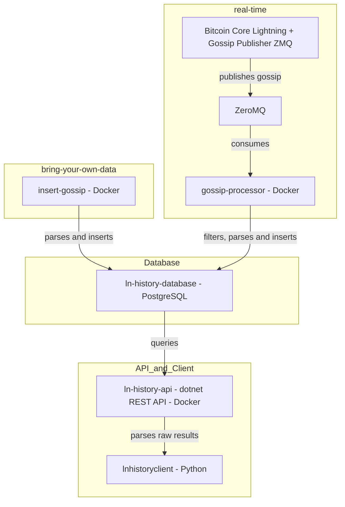

import { Badge } from '@rspress/theme-default';
import Terminal from '/src/components/Terminal';
import TerminalOneLiner from '/src/components/TerminalOneLiner.tsx';

# Introduction

Welcome to the documentation of the ln-history project. In this guide we will build the infrastructure to persist gossip messages of the Bitcoin Lightning network.
I tried to make this setup process as simple as possible. If you struggle at some point or find an error, feel free to create an Github Issue [here](https://github.com/ln-history/.github/issues).

## Project structure

Depending on your preferences, ln-history can be used in three different _modes_:

| Mode       | Description                                                            | Difficulty                             |
| -------------- | ---------------------------------------------------------------------- | -------------------------------------- |
| **[Direct Request](./direct_request/index.mdx)** |    _Request_ the ln-history infrastructure and parse results locally      | <Badge text="very easy" type="info" />       |
| **[Bring Your Own Data](./bring_your_own_data/index.mdx)** | _Bulk_ insert your self collected gossip messages into the database _once_         | <Badge text="easy" type="tip" />       |
| **[Real Time](./real_time/index.mdx)**   | Insert your collected gossip messages _in real time_ into the database | <Badge text="harder" type="warning" /> |

The following diagram shows you which steps you need to fulfill to setup the infrastructure. The platform supports running **bulk-import** and **real-time** simultaneously.



I recommend the easiest mode for starters to familiarize yourself, see  **[direct_request](./direct_request/index.mdx)**.
Here you can play around with gossip messages from the ln-history plaform that I have collected, like creating snapshots etc.

The **Bring Your Own Data** and **Real Time** mode should run on a server and utilize [docker compose](https://docs.docker.com/compose). 
The latter will also need a running [Bitcoin Core node](https://bitcoin.org/en/bitcoin-core/) as well as [Core Lightning node(s)](https://docs.corelightning.org/docs/home).
I have tested the **real-time** mode with an static ipv4 address _attached_ to the Core Lightning node.

After finishing the setup you will be provided with endpoints:
- Snapshot generation for a given timestamp
- Snapshot diff calculation for two given timestamps
- Gossip by `node_id` for a given timestamp
- Gossip by `scid` for a given timestamp

Note that the format of the results is _raw bytes_. They need to get parsed by a client.
The [lnhistoryclient](https://pypi.org/project/lnhistoryclient/) is a python package that provides classes, functions and interfaces to easly parse the gossip (in raw bytes) results into more readable formats, featuring [JSON](https://www.json.org/json-en.html) and [python networkx](https://networkx.org/).

When deploying the **real-time** mode you can also get live gossip analysis, see for example [here](https://app.ln-history.info/public-dashboards/e77a06ed751a4f838b72cda0f4eb6d64)

## Architecture

Here you can see an visualization of the architecture


## I do not have any gossip messages

You can still use this tool and do it yourself.
[Dr. Christian Decker](https://scholar.google.ch/citations?user=ZaeGlZIAAAAJ&hl=de) collected and uploaded gossip messages ranging between `01-2018` to `09-2023`.
See this [repository](https://github.com/lnresearch/topology/tree/main), which provides links to his gossip messages.
You can download this data for free.

With [ln-history](ln-history.info) I provide the infrastructure to analyze the gossip messages. Maybe this is all you are looking for?


## Prerequisits

The infrastructure relies on [docker](https://docker.com) (and [docker compose](https://docs.docker.com/compose/)) trying to make it as platform independent as possible. _Nonetheless, I highly recommend running it on a Linux machine (specifically [Ubuntu](https://ubuntu.com/)), as that is the only environment I tested it on._

### Docker installation

We follow the [official documentation](https://docs.docker.com/engine/install/ubuntu/).

1. Setup up Docker's `apt` repository

2. Install the (latest) Docker packages

   <TerminalOneLiner command="sudo apt-get install docker-ce docker-ce-cli
    containerd.io docker-buildx-plugin docker-compose-plugin" />

3. Verify that the installation is successful by running the hello-world image and check if you should see this result:

<Terminal command="sudo docker run hello-world">
Hello from Docker!
This message shows that your installation appears to be working correctly.

To generate this message, Docker took the following steps:

1.  The Docker client contacted the Docker daemon.
2.  The Docker daemon pulled the "hello-world" image from the Docker Hub.
    (amd64)
3.  The Docker daemon created a new container from that image which runs the
    executable that produces the output you are currently reading.
4.  The Docker daemon streamed that output to the Docker client, which sent it
    to your terminal.

To try something more ambitious, you can run an Ubuntu container with:
$ docker run -it ubuntu bash

</Terminal>

### Docker compose installation

We follow the [official documentation](https://docs.docker.com/compose/install/standalone/)

1. We download and install the Docker Compose standalone

   <TerminalOneLiner command="curl -SL https://github.com/docker/compose/releases/download/v2.39.1/docker-compose-linux-x86_64 -o /usr/local/bin/docker-compose" />

2. We apply executable permissions to the standalone binary in the target path for the installation
   <TerminalOneLiner command="chmod +x /usr/local/bin/docker-compose" />

## Folder structure <Badge text="optional" type="tip" />

On your machine navigate to your desired location where the project will live. You might want to create a specific user for that.

### Create user 

<TerminalOneLiner command="sudo adduser lnh" />

You can then add this user to the `sudo` group if needed:

<TerminalOneLiner command="sudo usermod -aG sudo lnh" />

Switch to the new user:

<TerminalOneLiner command="su - lnh" />

### Folder creation

We will now create the project root folder **ln-history** where all the services will be created in.

<TerminalOneLiner command="mkdir ln-history && cd ln-history" />

```
ln-history/
├── .env                    # Environment variables
├── docker-compose.yml      # Docker Compose setup
└── service-name.conf       # Optional configuration file(s)
```


## Ready - Set - Go

First setup the [ln-history Core](./ln_history_core.mdx) which consists of the database and the Backend.
After that continue with [Bring Your Own Data](./bring_your_own_data/index.mdx) or [Real Time](./real_time/index.mdx) depending on which mode you want to use.

In case you want to learn about the structure and format of Lightning Network gossip messages, please check out the [gossip](gossip_format.md) page.
